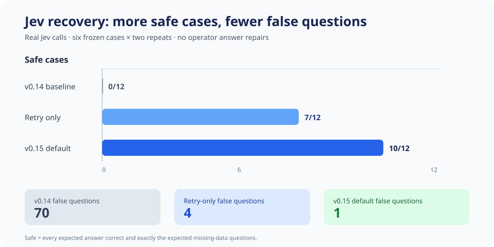
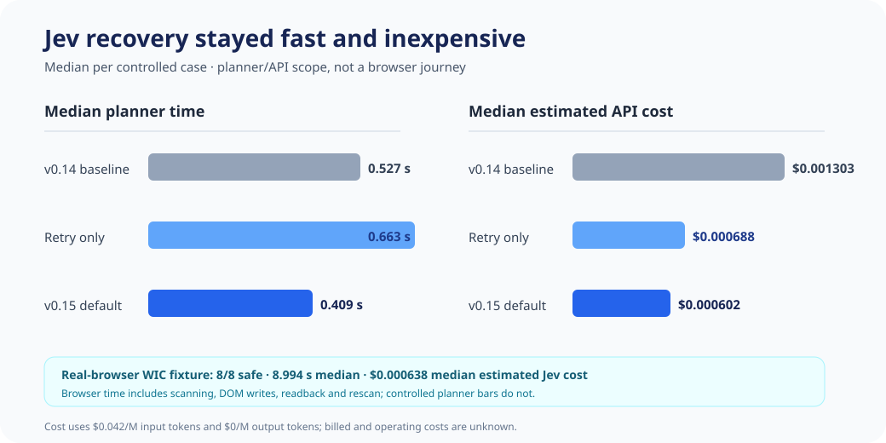

# Jev recovery evaluation · v0.15

Date published: 2026-10-13

Version 0.15 tests whether a bounded recovery loop and exact site rules can preserve Jev's speed while removing the blocking errors observed in the installed v0.14 WIC runs. The result is promising for WIC, but it is not evidence that Jev alone solved every field or that the extension completed a live application.

## What changed

The extension now distinguishes four sources of a field decision:

- **Jev initial:** `jev-1.13.0` classified the field at or above the unchanged 0.90 confidence threshold.
- **Jev retry:** one smaller follow-up request reconsidered only Jev-deferred controls.
- **Site rule:** a deterministic rule handled an exact, trusted WIC control, such as the full-address format or a conditional Medi-Cal field.
- **Verified reuse:** a rescan reused a mapping only after the DOM value matched the source record. Cache entries are scoped to the page, document and source fingerprint.

The runner still pauses for missing source data, blocked writes, unsupported controls, CAPTCHA, and final submission. It does not lower Jev's confidence threshold or silently guess missing answers.

## Controlled comparison

The controlled batch made real authenticated Jev calls over six frozen inventories, twice each: four WIC cases, one IHSS diagnostic subset, and one CalFresh diagnostic subset. Writes were simulated, so the timings below measure local planning and API response rather than a browser journey.

| Variant | Safe cases / 12 | Median planner time | False questions | Model calls | Input / output tokens | Median estimated cost per case |
|---|---:|---:|---:|---:|---:|---:|
| Frozen v0.14 baseline | 0/12 | 0.527 s | 70 | 24 | 296,588 / 117,428 | $0.001303 |
| v0.15 retry only | 7/12 | 0.663 s | 4 | 38 | 189,551 / 65,555 | $0.000688 |
| v0.15 default: retry + exact rules + verified reuse | **10/12** | **0.409 s** | **1** | 24 | 159,816 / 58,502 | **$0.000602** |

“Safe” means every expected answer agreed with the synthetic source and the runner asked exactly the expected missing-data questions. No operator supplied or repaired an answer. The default passed all eight WIC cases and both IHSS diagnostic cases. It failed both CalFresh diagnostic repeats.

## Real-browser WIC fixture

The browser batch exercised the current production scanner, form engine, writer/readback path, and real Jev API against a local WIC DOM. It ran four synthetic cases twice. Submit was disabled. This is stronger evidence than a frozen inventory, but it is not an installed-extension or live-site result.

| Browser trial | Correct answers | Expected questions | Time | Calls | Input / output tokens | Estimated Jev cost |
|---|---:|---|---:|---:|---:|---:|
| Medi-Cal No; same address · r1 | 17/17 | None | 8.766 s | 1 | 13,889 / 5,608 | $0.000583 |
| Medi-Cal No; same address · r2 | 17/17 | None | 8.486 s | 1 | 13,919 / 5,608 | $0.000585 |
| Medi-Cal Yes; different address · r1 | 19/19 | None | 9.749 s | 1 | 15,793 / 6,500 | $0.000663 |
| Medi-Cal Yes; different address · r2 | 19/19 | None | 10.112 s | 1 | 15,827 / 6,500 | $0.000665 |
| Missing Medi-Cal case number · r1 | 18/18 | Case number | 9.560 s | 2 | 17,114 / 6,617 | $0.000719 |
| Missing Medi-Cal case number · r2 | 18/18 | Case number | 9.221 s | 2 | 17,150 / 6,617 | $0.000720 |
| Missing home ZIP · r1 | 16/16 | Home and mailing address | 8.568 s | 2 | 14,581 / 5,436 | $0.000612 |
| Missing home ZIP · r2 | 16/16 | Home and mailing address | 8.152 s | 2 | 14,581 / 5,436 | $0.000612 |
| **Batch** | **8/8 safe trials** | Exact in all 8 | **8.994 s median** | **12** | **122,854 / 48,322** | **$0.005160 total** |

All browser writes were read back. There were zero incorrect answers, unexpected questions, blocked writes, or operator answer repairs. Complete records reached the fixture's final review boundary; incomplete records paused on the expected missing fields.

The browser median is comparable to the installed v0.14 Jev time of about 8.4 seconds because both include a complete WIC scan/fill/rescan path. The controlled planner median of 0.409 seconds is a narrower API/planning measurement and should not be compared directly with browser or installed-extension duration.

## Error attribution

| Earlier failure | v0.15 result | What produced the result |
|---|---|---|
| Home Address contained only street and unit | Resolved in all WIC trials | Exact WIC full-address format plus source-completeness check |
| Known Medi-Cal answer was deferred | Resolved in all complete WIC trials | Jev when confident; otherwise exact WIC rule |
| Mailing and case-number controls became false questions | Resolved | Conditional applicability rules |
| A rescan changed or duplicated previously verified mappings | Resolved in browser fixture | DOM readback plus document/source-scoped verified reuse |
| Missing source values could be mistaken for optional fields | Resolved in WIC cases | Explicit expected questions; no guessed fill |
| CalFresh “Stable housing” did not map to “No” for homelessness | **Still fails** in both controlled repeats | Generic semantic transformation is missing |
| CalFresh county classification varied at threshold | **Still unstable** in one controlled repeat | Jev confidence varied; no exact rule exists |

This distinction matters: Jev was responsible for most first-pass classifications, while deterministic policy supplied up to two WIC mappings in a trial and verified reuse handled the second scan. The retry-only variant's 7/12 result shows that looping helps, but looping alone did not match the 10/12 default and required 38 calls instead of 24.

## Cost and scope

Estimates use TypeSafe's published Jev 1.13 rate of **$0.042 per million input tokens and $0 for output tokens**. `apiCostUsd` and `providerReportedCostUsd` were not returned, so these are calculated estimates rather than invoices. Device, companion-service, networking and engineering costs are unmeasured.

No CAPTCHA was presented or attempted in this batch. Jev's tested TypeSafe route accepts text/JSON and has no image adapter in this extension, so this evaluation makes no Jev CAPTCHA claim. No application was submitted.

Machine-readable receipts: [controlled comparison](../evaluation/results/jev-recovery-v015.json) · [browser fixture](../evaluation/results/jev-recovery-browser-v015.json).
